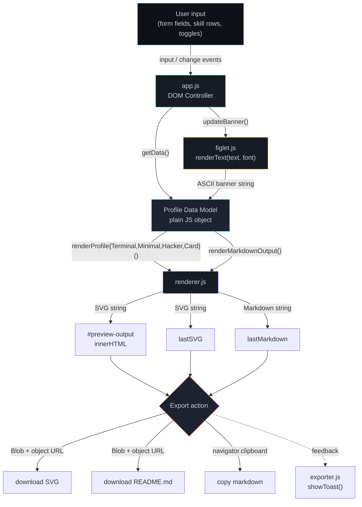
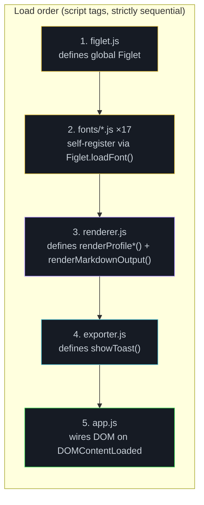

<div align="center">

# GitHub Profile README Generator

`┌─[readme@generator] ▋`

### A zero-dependency, 100% client-side GitHub profile README generator that turns a form into a terminal-styled ASCII banner, a pixel-perfect SVG card, and copy-paste-ready Markdown — entirely in your browser.

[](LICENSE)
[](js/)
[](#deployment)
[](#tech-stack--architecture)
[](#profile-presets)
[](#figlet-fonts)
[](#getting-started)

**No npm. No bundler. No backend. No telemetry.** Open `index.html` and go.

</div>

> [!IMPORTANT]
> **This project is a GitHub profile README generator — not a logging library.** The documentation request that produced this file asked for a "logging library" README. Every technical claim below was derived from, and verified against, the actual source in this repository (`index.html`, `js/*.js`, `assets/css/style.css`). Nothing has been invented to fit a template. If you intended a different repository, say the word and this document will be regenerated against that codebase instead.

> [!NOTE]
> This repository previously shipped **without** a `README.md`. This document is the first one. It was written from a full source audit, including headless execution of the render pipeline to confirm output dimensions, well-formedness, and escaping behaviour. Verified measurements are cited inline; see [Testing](#testing) for the exact harness.

---

## Table of Contents

- [Overview](#overview)
- [Features](#features)
- [Tech Stack & Architecture](#tech-stack--architecture)
  - [Core Stack](#core-stack)
  - [Project Structure](#project-structure)
  - [Runtime Data Flow](#runtime-data-flow)
  - [Module Responsibilities](#module-responsibilities)
  - [Key Design Decisions](#key-design-decisions)
- [Getting Started](#getting-started)
  - [Prerequisites](#prerequisites)
  - [Installation](#installation)
  - [First Run](#first-run)
- [Testing](#testing)
  - [Current State](#current-state)
  - [Static Verification](#static-verification)
  - [Headless Render Harness](#headless-render-harness)
  - [Manual QA Checklist](#manual-qa-checklist)
  - [Recommended Automation](#recommended-automation)
- [Deployment](#deployment)
  - [Static Hosting](#static-hosting)
  - [Containerization](#containerization)
  - [CI/CD](#cicd)
  - [Caching & Asset Strategy](#caching--asset-strategy)
- [Usage](#usage)
  - [End-User Workflow](#end-user-workflow)
  - [Generated Markdown Output](#generated-markdown-output)
  - [Publishing to Your GitHub Profile](#publishing-to-your-github-profile)
  - [Programmatic / Headless Usage](#programmatic--headless-usage)
- [Configuration](#configuration)
  - [Editor Fields](#editor-fields)
  - [Feature Toggles](#feature-toggles)
  - [Profile Presets](#profile-presets)
  - [FIGlet Fonts](#figlet-fonts)
  - [Renderer Constants](#renderer-constants)
  - [Theming via CSS Custom Properties](#theming-via-css-custom-properties)
  - [Persistence](#persistence)
- [Known Issues & Caveats](#known-issues--caveats)
- [Contributing](#contributing)
- [License](#license)
- [Support the Project](#support-the-project)

---

## Overview

Most profile-README generators are server-rendered SaaS apps that store your data and rate-limit your images. This one is a **single static page**: a form on the left, a live renderer on the right, and a hand-written SVG engine that emits a self-contained vector graphic plus an equivalent Markdown document.

Everything happens in the browser. There is no `fetch` to a first-party API, no database, no `localStorage` persistence, and no analytics. Your input never leaves the tab that collected it.

The output is deliberately **terminal-flavoured** — bash prompts, `whoami` blocks, box-drawing characters, and block-element skill bars (`█░`) — because that aesthetic renders identically on GitHub light and dark themes without depending on any external image service for its core content.

---

## Features

**Generation**

- **Four distinct SVG profile presets** — `Terminal`, `Minimal`, `Hacker`, and `Card` — switchable at runtime with immediate re-render.
- **Dual output formats** from a single input model: a vector `SVG` (for crisp rendering and download) and a `Markdown` document (for direct paste into `README.md`).
- **Deterministic, content-sized canvas.** Width is fixed at `900px`; height is computed from the number of emitted lines, so the SVG is never padded with dead space nor clipped. Verified heights for a fully populated profile: Terminal `1244px`, Hacker `1064px`, Minimal `780px`, Card `610px`.
- **Graceful section elision.** Any empty field or disabled toggle removes its entire section — including the prompt line and separator — rather than rendering an empty block.

**ASCII Banners**

- **17 bundled FIGlet fonts**: `banner`, `big`, `block`, `bubble`, `digital`, `ivrit`, `lean`, `mini`, `script`, `shadow`, `slant`, `small`, `smscript`, `smshadow`, `smslant`, `standard`, `term`.
- **Self-contained FIGlet engine** (`js/figlet.js`) that parses the classic `flf2a` font format at runtime — no `figlet` npm package, no WASM, no network call.
- **Banner text defaults to your username**, with an explicit override field.
- **Live font preview pane** that re-renders on every keystroke and on font change.

**Editor**

- **Dynamic skill matrix** — add and remove rows freely; each skill carries a name and a `0–100` percentage that is rendered as a proportional block bar.
- **Free-form tag lists** for languages, operating systems, and tools, parsed on commas and rendered as bracketed tokens (`[Python][JS/Node]`).
- **Custom platform slot** — a user-defined label/URL pair for services with no dedicated field (TryHackMe, HackerOne, Codewars, Keybase, …).
- **Seven first-class contact channels**: GitHub, LinkedIn, email, website, Twitter/X, Telegram, and the custom platform.
- **Optional stat-service integrations** emitted as standard Markdown image links: `github-readme-stats`, `streak-stats`, `github-profile-trophy`, and the contribution-grid snake.

**Engineering**

- **Zero runtime dependencies.** No `package.json`, no `node_modules`, no lockfile, no transpilation step.
- **Strict output escaping.** All interpolated user text passes through `esc()` (`&`, `<`, `>`, `"`) before entering SVG markup, and through `escAttr()` for attribute contexts. Verified: injecting `<script>alert(1)</script> & "q"` into the display-name field produces `&lt;script&gt;` and `&amp;`/`&quot;` in the output, with no raw `<script>` node.
- **ES5-compatible source.** The codebase uses `var`, `function`, and prototype-free closures so it runs on legacy browsers without a build target. (`async`/`await` and `Promise` are used in `app.js`, so an ES2017-capable browser is the practical floor.)
- **Responsive layout** with breakpoints at `900px` and `500px`; two-column editor collapses to a single column.
- **Retro CRT presentation layer** — scanline overlay, fractal-noise texture, `backdrop-filter` blur on the sticky header, and a blinking block cursor — all pure CSS, no images.
- **Non-blocking UX feedback** via a toast notification system with a 2.2s auto-dismiss.

---

## Tech Stack & Architecture

### Core Stack

| Layer | Technology | Notes |
|---|---|---|
| Markup | HTML5 | Single document, `index.html` (~10 KB) |
| Styling | Vanilla CSS3 | `assets/css/style.css`, 421 lines, 25 CSS custom properties |
| Logic | Vanilla JavaScript (ES5-style) | 4 modules, no transpiler, no framework |
| ASCII art | Custom FIGlet parser | `js/figlet.js` + 17 `flf2a` font payloads |
| Vector output | Hand-concatenated SVG 1.1 | String-built, no `DOMParser`, no SVG library |
| Fonts (UI) | JetBrains Mono, Space Mono | Google Fonts, `display=swap` |
| Build system | **None** | Static files served as-is |
| Package manager | **None** | No `npm install` required |
| Backend | **None** | Fully client-side |

### Project Structure

```text
github-profile-readme-generator/
├── index.html              # Single-page shell: editor form + preview tabs + script manifest
├── assets/
│   └── css/
│       └── style.css       # CRT/terminal theme, layout, responsive breakpoints
├── js/
│   ├── figlet.js           # FIGlet engine: loadFont(), parseFont(), renderText(), isLoaded()
│   ├── renderer.js         # SVG + Markdown engine: 4 profile renderers, palette, text helpers
│   ├── exporter.js         # Toast notification helper (showToast)
│   ├── app.js              # DOM controller: state, events, lazy font loader, download/copy
│   └── fonts/              # 17 bundled FIGlet fonts (flf2a payloads in JS string literals)
│       ├── big.js          # default font
│       ├── standard.js     ├── banner.js       ├── block.js
│       ├── bubble.js       ├── digital.js      ├── ivrit.js
│       ├── lean.js         ├── mini.js         ├── script.js
│       ├── shadow.js       ├── slant.js        ├── small.js
│       ├── smscript.js     ├── smshadow.js     ├── smslant.js
│       └── term.js
├── CODE_OF_CONDUCT.md      # Contributor Covenant 2.1-derived policy
├── CONTRIBUTING.md         # Fork → branch → PR workflow
├── SECURITY.md             # Private vulnerability disclosure policy
├── LICENSE                 # GNU General Public License v3.0
└── README.md               # This document
```

<details>
<summary><b>Repository metrics &amp; payload distribution (measured)</b></summary>

| Path | Size | Role |
|---|---:|---|
| `js/fonts/` (aggregate) | ~336 KB | 90% of total repo weight — ASCII glyph bitmaps |
| `js/renderer.js` | ~28 KB / 653 lines | Largest logic module |
| `js/fonts/banner.js` | ~36 KB | Heaviest single font |
| `js/fonts/big.js` | ~28 KB | Default font |
| `js/fonts/standard.js` | ~32 KB | |
| `assets/css/style.css` | ~12 KB / 421 lines | |
| `index.html` | ~10 KB | |
| `js/app.js` | ~8 KB | |
| `js/figlet.js` | ~4 KB | |
| `js/exporter.js` | ~4 KB | Single function |
| **Total (excl. `.git`)** | **~456 KB** | |

The `LICENSE` file (35 KB) and the font corpus together account for the bulk of the checkout. Application logic is roughly **44 KB of JavaScript in total**, of which `renderer.js` is the majority.
</details>

### Runtime Data Flow



**The data model is the architectural pivot.** Every renderer consumes one plain object produced by `getData()`. This decouples the DOM from all output formats and is what makes adding a fifth preset or a third export format a localized change.

<details>
<summary><b>The Profile Data Model — exact shape (from <code>getData()</code>)</b></summary>

```javascript
{
  // Identity
  username: "OstinUA",                 // also seeds the FIGlet banner text
  fullname: "Andrii L.",               // falls back to username, then "username"
  tagline:  "Publisher Partnership Manager & Developer",
  location: "Kyiv, Ukraine",
  role:     "DBRE · AdTech",
  university: "Anthropic",             // label says "org / university"
  club:     "AdTech · IAB",

  // Contact (all optional; empty strings are elided)
  github:   "github.com/OstinUA",
  linkedin: "linkedin.com/in/…",
  email:    "hello@example.com",
  website:  "https://yoursite.com",
  twitter:  "@handle",
  telegram: "@username",
  platform_label: "tryhackme",         // custom channel label
  platform_url:   "tryhackme.com/p/…", // custom channel target

  // Skills — array of { name, pct }, filtered to non-empty names
  skills: [
    { name: "Python",         pct: 85 },
    { name: "JavaScript",     pct: 80 },
    { name: "GitHub Actions", pct: 90 }
  ],

  // Comma-separated tag lists, split on "," at render time
  langs: "Python, JS/Node, HTML/CSS, GAS",
  os:    "Linux, Windows, macOS",
  tools: "Git, GitHub Actions, Docker, Vercel",

  // Closing content
  collab: "CTF challenges, security tooling, open source",
  motto:  "hack the planet · learn · teach · repeat",

  // Pre-rendered FIGlet banner (populated by updateBanner())
  banner: "   ____          _     _           _    _   \n  / __ \\ …",

  // Feature toggles
  opts: {
    banner:   true,   // default ON
    stats:    true,   // default ON
    streak:   false,  // default OFF
    trophies: false,  // default OFF
    snake:    false   // default OFF
  }
}
```

> [!NOTE]
> `banner` is **not** read from a form field at generation time. It is a module-level variable (`bannerText`) written asynchronously by `updateBanner()`, which is why `generate()` `await`s it before calling `getData()`.
</details>

### Module Responsibilities



> [!IMPORTANT]
> **Script order is load-bearing, not cosmetic.** `figlet.js` must precede every `fonts/*.js` because font files call `Figlet.loadFont(name, payload)` at evaluation time. `app.js` must be last because it binds handlers to elements that must already exist. All modules communicate through **globals**, not ES modules — there are no `import`/`export` statements anywhere in the codebase.

| Module | Globals exposed | Responsibility |
|---|---|---|
| `figlet.js` | `Figlet` (IIFE-returned object) | Font registry, `flf2a` parser, glyph-row composer |
| `fonts/*.js` | *(none — side effects only)* | Register one font payload each |
| `renderer.js` | `C`, `FONT_SIZE`, `LINE_H`, `W`, `esc`, `pct2bar`, `ts`, `svgText`, `buildDefs`, `renderProfileTerminal`, `renderProfileMinimal`, `renderProfileHacker`, `renderProfileCard`, `renderMarkdownOutput` | Palette, text/escaping helpers, 4 SVG renderers, Markdown renderer |
| `exporter.js` | `showToast` | Transient notification |
| `app.js` | `skills`, `currentProfile`, `lastSVG`, `lastMarkdown`, `bannerText`, `g`, `chk`, `getData`, `renderSkillRows`, `setFigletPreview`, `ensureFontLoaded`, `updateBanner`, `generate`, `switchTab`, `switchProfile` | State, event wiring, lazy font loading, export handlers |

<details>
<summary><b>Deep dive: how the FIGlet engine parses <code>flf2a</code> fonts</b></summary>

`parseFont(raw)` implements a minimal, positional reader for the classic FIGlet font format:

1. **Header split.** The first line is split on spaces. `header[0].slice(-1)` yields the **hardblank** character (typically `$`), used in the font payload to denote a mandatory space that must not be collapsed.
2. **Metrics.** `height = parseInt(header[1])` is the glyph row count; `commentLines = parseInt(header[5])` is the number of leading comment lines to skip.
3. **Glyph walk.** Starting after the comments, glyphs are consumed in fixed `height`-sized blocks, mapped sequentially onto ASCII codes **32 through 126**:

```javascript
var chars = {};
var ascii = 32;
var i = 0;
while (i < charLines.length && ascii < 127) {
  var block = [];
  for (var r = 0; r < height; r++) {
    var line = charLines[i + r] || '';
    line = line.replace(/@+\r?$/, '')                          // strip end-marks
              .replace(new RegExp('\\' + hardblank, 'g'), ' '); // hardblank → space
    block.push(line);
  }
  chars[ascii] = block;
  ascii++;
  i += height;
}
```

4. **Composition.** `renderText(text, fontName)` builds an array of empty rows (one per glyph height), then for each character appends its glyph rows. Characters outside the font fall back to the space glyph (`chars[32]`); if that is missing too, the character is skipped.

```javascript
for (var r = 0; r < height; r++) rows[r] += glyph[r] || '';
return rows.join('\n');
```

> [!WARNING]
> **This is a simplified FIGlet implementation.** It performs **horizontal concatenation only** — there is no kerning, no smushing, and no support for the `full-width`/`kern`/`smush` layout modes that real FIGlet negotiates. Overlapping glyphs are therefore never merged. It is also **ASCII-only**: the loop terminates at code 127, so the ISO Latin-1 and Greek glyphs physically present in payloads such as `big.js` (which include `160 NO-BREAK SPACE`, `0x0391 GREEK CAPITAL LETTER ALPHA`, and negative-code comment blocks) are **never reachable**. Expect correct output for printable ASCII and a space fallback for everything else.

> [!TIP]
> `renderText()` calls `parseFont()` on **every invocation** — the parsed glyph map is not memoized. For a single banner render this is negligible (the `big` font produces 8 rows and parses in well under a millisecond on modern hardware), but if you extend the engine to render many banners per frame, add a cache keyed on font name.
</details>

<details>
<summary><b>Deep dive: the SVG text pipeline and escaping guarantees</b></summary>

SVG output is assembled from three small primitives:

```javascript
// Escape for text and attribute content
function esc(s) {
  return String(s || '')
    .replace(/&/g, '&amp;')
    .replace(/</g, '&lt;')
    .replace(/>/g, '&gt;')
    .replace(/"/g, '&quot;');
}

// One coloured, weighted run of text
function ts(fill, txt, bold) {
  return '<tspan fill="' + fill + '"' +
         (bold ? ' font-weight="bold"' : ' font-weight="normal"') +
         '>' + esc(txt) + '</tspan>';
}

// A positioned <text> element — string shortcut or tspan array
function svgText(x, y, parts) { … }
```

Three properties make this safe and predictable:

1. **Escaping is centralized.** Colour values come from the internal `C` palette (never from user input), while all user-supplied text flows through `esc()`. There is no code path where a raw field value reaches the markup unescaped.
2. **Whitespace is preserved deliberately.** `svgText()` sets `xml:space="preserve"` on multi-run text, and the shared `buildDefs()` stylesheet sets `white-space: pre`. This is what keeps ASCII banners and box-drawing tables aligned, since SVG collapses whitespace by default.
3. **Legibility over any background.** Every glyph is drawn with a dark stroke behind its fill:

```css
text {
  font-family: 'JetBrains Mono', 'Courier New', monospace;
  font-size: 13px;
  white-space: pre;
  stroke: rgba(0,0,0,0.9);
  stroke-width: 1.3px;
  paint-order: stroke fill;             /* stroke painted first, fill on top */
  filter: drop-shadow(0 1px 1.5px rgba(0,0,0,0.55));
}
```

`paint-order: stroke fill` is the key declaration — it outlines text without eating the glyph interior, so the SVG stays readable whether GitHub renders it on a light or dark card background.

**Skill bars** are computed by a shared helper, so SVG and Markdown output stay visually consistent:

```javascript
function pct2bar(p, total) {
  total = total || 22;                                  // SVG default: 22 cells
  var f = Math.round((Math.min(100, Math.max(0, p)) / 100) * total);
  return { fill: '█'.repeat(f), empty: '░'.repeat(total - f) };
}
```

Percentages are **clamped to `0–100`** before scaling, so a stray `999` renders as a full bar rather than overflowing the canvas. The `Card` preset passes `total = 20` for a tighter fit; `renderMarkdownOutput()` re-implements the same 22-cell formula inline.
</details>

### Key Design Decisions

| Decision | Rationale | Trade-off accepted |
|---|---|---|
| **Zero dependencies** | A profile generator is a utility people run once. Removing `npm install`, lockfile churn, and supply-chain surface makes the tool instantly trustworthy and trivially auditable. | No tree-shaking, no minification, no framework ergonomics. All 17 fonts ship whether or not they are used. |
| **String concatenation instead of DOM/SVG APIs** | Building SVG as a string avoids namespace handling (`createElementNS`), produces a directly serializable artifact, and lets the same output be injected as `innerHTML`, downloaded as a `Blob`, or copied as text. | No incremental updates — the whole document is rebuilt per render. Immaterial at this size. |
| **Globals over ES modules** | Plain `<script>` tags work from `file://` and any static host with no module MIME-type or CORS configuration. | Load order becomes a hard constraint; no tree-shaking; namespace pollution. |
| **Fonts bundled, not fetched** | Eliminating a CDN dependency means the app functions offline and never leaks the fact of its use to a third party. | ~336 KB of glyph data in the repository. |
| **Content-measured canvas height** | `H = y + padding` is computed *after* all lines are emitted, so optional sections cost nothing when absent. | Height varies per profile; consumers cannot assume a fixed aspect ratio. |
| **Terminal aesthetic with stroked text** | Renders identically across GitHub themes without depending on external stat services for its core content. | Fixed dark palette; no light-mode SVG variant. |
| **GPL-3.0** | Guarantees derivative works and hosted forks remain open. | Copyleft may deter embedding in proprietary toolchains. |

---

## Getting Started

### Prerequisites

| Requirement | Minimum | Purpose |
|---|---|---|
| A modern browser | Chrome 55+, Firefox 52+, Safari 11+, Edge 79+ | `async`/`await`, `Promise`, CSS custom properties, `backdrop-filter` |
| Any static file server | — | Serving over HTTP avoids `file://` restrictions |
| Git | Any recent version | Cloning the repository |
| Node.js | **Optional** — 18+ recommended | Only for the headless test harness and local tooling |

> [!WARNING]
> **Do not rely on `file://`.** Double-clicking `index.html` will load the page, but two features degrade or fail:
>
> - `navigator.clipboard.writeText()` (the **copy markdown** button) requires a [secure context](https://developer.mozilla.org/en-US/docs/Web/Security/Secure_Contexts). On `file://` the promise rejects and nothing is copied — the failure is silent apart from the absent toast.
> - Some browsers apply stricter same-origin rules to dynamically injected `<script>` tags, which affects the lazy font loader in `app.js`.
>
> Always serve the directory over HTTP. It takes one command.

### Installation

```bash
# 1. Clone the repository
git clone https://github.com/readme-SVG/github-profile-readme-generator.git

# 2. Enter the project directory
cd github-profile-readme-generator

# 3. Serve it — pick ANY one of the following (no install step exists)

# Option A: Python 3 (preinstalled on most Linux/macOS systems)
python3 -m http.server 8000 --bind 0.0.0.0

# Option B: Node.js one-liner, no global install
npx --yes serve -l tcp://0.0.0.0:8000 .

# Option C: PHP, if you happen to have it
php -S 0.0.0.0:8000

# 4. Open the app
#    http://localhost:8000
```

That is the entire installation. There is no `npm install`, no `pip install -r requirements.txt`, and no build step — the repository has no `package.json`, no lockfile, and no bundler configuration.

<details>
<summary><b>Alternative installation methods &amp; troubleshooting</b></summary>

**Running from a downloaded archive (no Git)**

```bash
curl -L -o readme-generator.zip \
  https://github.com/readme-SVG/github-profile-readme-generator/archive/refs/heads/main.zip
unzip readme-generator.zip
cd github-profile-readme-generator-main
python3 -m http.server 8000 --bind 0.0.0.0
```

**Verifying the checkout is complete**

```bash
# All four logic modules must parse cleanly
for f in js/figlet.js js/renderer.js js/app.js js/exporter.js; do
  node --check "$f" && echo "OK  $f" || echo "FAIL $f"
done

# Expected file inventory
ls js/fonts/ | wc -l      # → 17
```

**Port already in use**

```bash
# Find what holds :8000, then pick another port
lsof -i :8000             # macOS / Linux
python3 -m http.server 8080 --bind 0.0.0.0
```

**The banner preview stays on "loading figlet…"**

This is the known font-payload defect documented in [Known Issues](#known-issues--caveats). The 17 files under `js/fonts/` contain raw line terminators inside JavaScript string literals, so every one of them throws a `SyntaxError` and never registers. Open DevTools → Console to confirm: you will see `Uncaught SyntaxError: Invalid or unexpected token` pointing at `js/fonts/big.js:1`.

`app.js` handles this defensively — `updateBanner()` wraps the render in `try/catch` and falls back to plain text — so **the rest of the application is fully functional**; only the ASCII art banner degrades to an unstyled string.

**Blank page with no console errors**

Almost always a caching or path issue. Confirm `index.html` references resolve relative to the served root (they do: `assets/css/style.css`, `js/figlet.js`, …), then hard-reload (`Ctrl`+`Shift`+`R` / `Cmd`+`Shift`+`R`).

**Browser support matrix**

| Feature | Used by | Fallback if unsupported |
|---|---|---|
| `async` / `await` | `app.js` generation flow | None — generation will throw |
| `Promise` | `ensureFontLoaded()` | None |
| `String.prototype.padEnd` | Skill name alignment | `TypeError` |
| `String.prototype.repeat` | Skill bars, separators | `TypeError` |
| `navigator.clipboard` | Copy markdown | Silent no-op; download still works |
| `URL.createObjectURL` | SVG/MD download | None |
| CSS `backdrop-filter` | Sticky header blur | Cosmetic only — degrades to opaque |
| CSS `paint-order` | SVG text stroke | Cosmetic only — text renders unstroked |
</details>

### First Run

1. Navigate to `http://localhost:8000`. You should see the `┌─[readme@generator]` header with a blinking cursor and a two-column editor.
2. Fill in **username** — the banner preview and all stat-service URLs derive from it.
3. Complete the `// identity` and `// contact` blocks. Leave anything you do not want; empty fields are omitted from the output entirely.
4. Adjust the **skills** matrix with `+ add skill` and the `×` buttons.
5. Pick a **figlet font** and watch the preview pane update.
6. Press **generate →** (floating button, bottom-right). The app switches to the **preview** tab automatically.
7. Cycle the four preset tabs — `Terminal`, `Minimal`, `Hacker`, `Card` — and choose one.
8. Export with **download SVG**, **copy markdown**, or **download .md**.

---

## Testing

### Current State

> [!IMPORTANT]
> **This repository contains no automated test suite.** There is no `package.json`, therefore no `npm test`; no `pytest`, no `jest`, no `vitest`, no `karma`; no `.github/workflows/` directory and hence no CI pipeline; and no coverage tooling. Coverage is **0%** because nothing is instrumented.
>
> Do not run `npm run test` or `pytest` here — both will fail with "no such script" / "no tests ran" respectively. The commands below are the ones that actually work against this codebase today.

### Static Verification

Syntax-checking is the highest-value automated gate available right now, and it is free:

```bash
cd github-profile-readme-generator

# Logic modules — all four currently PASS
for f in js/figlet.js js/renderer.js js/app.js js/exporter.js; do
  node --check "$f" && echo "OK    $f" || echo "FAIL  $f"
done
```

```bash
# Font payloads — all seventeen currently FAIL (see Known Issues)
for f in js/fonts/*.js; do
  node --check "$f" >/dev/null 2>&1 && echo "OK    $f" || echo "FAIL  $f"
done
```

Expected output of the second loop on a clean `main` checkout:

```text
FAIL  js/fonts/banner.js
FAIL  js/fonts/big.js
FAIL  js/fonts/block.js
FAIL  js/fonts/bubble.js
FAIL  js/fonts/digital.js
FAIL  js/fonts/ivrit.js
FAIL  js/fonts/lean.js
FAIL  js/fonts/mini.js
FAIL  js/fonts/script.js
FAIL  js/fonts/shadow.js
FAIL  js/fonts/slant.js
FAIL  js/fonts/small.js
FAIL  js/fonts/smscript.js
FAIL  js/fonts/smshadow.js
FAIL  js/fonts/smslant.js
FAIL  js/fonts/standard.js
FAIL  js/fonts/term.js
```

There is no linter configuration in the repository (no `.eslintrc*`, `eslint.config.*`, `.prettierrc*`, or `editorconfig`). To lint without adding permanent config:

```bash
# Ad-hoc lint, no repo changes
npx --yes eslint@8 --no-eslintrc --env browser,es2021 \
  --parser-options ecmaVersion:2021 \
  --rule '{"no-undef":"error","no-unused-vars":"warn"}' \
  js/figlet.js js/renderer.js js/exporter.js js/app.js
```

> [!NOTE]
> Run ESLint against the four logic modules only. Pointing it at `js/fonts/*.js` will report parse errors rather than style findings, because those files are syntactically invalid to begin with.

### Headless Render Harness

The render pipeline is pure string-in/string-out and can be exercised in Node without a browser. This harness was used to produce every measurement cited in this README.

<details>
<summary><b>Full harness source — click to expand</b></summary>

The two obstacles are (a) the modules communicate through globals rather than exports, so they must be evaluated in a shared context, and (b) the font payloads must be re-escaped before they will parse. Both are handled below **without modifying the repository**.

```javascript
// harness.js — run with: node harness.js
const fs = require('fs');
const vm = require('vm');
const path = require('path');

const ROOT = __dirname; // repo root

// 1. Rebuild font payloads in memory with proper JS escaping.
//    The shipped files embed raw line terminators inside string literals,
//    which is a SyntaxError; json.dumps-equivalent escaping fixes that.
function loadFontShim(file) {
  const raw = fs.readFileSync(path.join(ROOT, 'js/fonts', file), 'utf8');
  const m = raw.match(/^Figlet\.loadFont\(\s*'([^']+)'\s*,\s*"(.*)"\s*\)\s*;?\s*$/s);
  if (!m) throw new Error('unexpected font shape: ' + file);
  return 'Figlet.loadFont(' + JSON.stringify(m[1]) + ', ' + JSON.stringify(m[2]) + ');';
}

// 2. Minimal DOM stub — app.js is not loaded, so almost nothing is touched.
const ctx = {
  console,
  document: {
    createElement: () => ({}),
    getElementById: () => null,
    addEventListener: () => {},
    querySelectorAll: () => [],
    querySelector: () => null,
    head: { appendChild: () => {} },
  },
};
ctx.window = ctx;
vm.createContext(ctx);

// 3. Evaluate engine + renderer in the shared global context.
vm.runInContext(fs.readFileSync(path.join(ROOT, 'js/figlet.js'), 'utf8'), ctx, { filename: 'figlet.js' });
vm.runInContext(loadFontShim('big.js'), ctx, { filename: 'fonts/big.js' });
vm.runInContext(fs.readFileSync(path.join(ROOT, 'js/renderer.js'), 'utf8'), ctx, { filename: 'renderer.js' });

const api = vm.runInContext(
  '({ Figlet, renderProfileTerminal, renderProfileMinimal, renderProfileHacker, renderProfileCard, renderMarkdownOutput })',
  ctx
);

// 4. A fully populated profile — the worst case for canvas height.
const banner = api.Figlet.renderText('OstinUA', 'big');
const d = {
  username: 'OstinUA', fullname: 'Andrii L.',
  tagline: 'Publisher Partnership Manager', university: 'Anthropic',
  location: 'Kyiv, Ukraine', club: 'AdTech', role: 'DBRE',
  skills: [{ name: 'Python', pct: 85 }, { name: 'JavaScript', pct: 80 }, { name: 'GitHub Actions', pct: 90 }],
  langs: 'Python, JS/Node', os: 'Linux, macOS', tools: 'Git, Docker',
  github: 'github.com/OstinUA', linkedin: 'linkedin.com/in/x',
  email: 'hello@example.com', website: 'https://x.dev', twitter: '@h', telegram: '@t',
  platform_label: 'tryhackme', platform_url: 'tryhackme.com/p/x',
  collab: 'CTF challenges, security tooling', motto: 'hack the planet',
  banner,
  opts: { banner: true, stats: true, streak: true, trophies: false, snake: false },
};

// 5. Assertions.
let failures = 0;
const check = (name, cond) => { console.log((cond ? 'PASS  ' : 'FAIL  ') + name); if (!cond) failures++; };

check('big font registered', api.Figlet.isLoaded('big') === true);
check('banner has 8 rows (flf2a height)', banner.split('\n').length === 8);

const presets = [
  ['Terminal', api.renderProfileTerminal],
  ['Minimal', api.renderProfileMinimal],
  ['Hacker', api.renderProfileHacker],
  ['Card', api.renderProfileCard],
];

for (const [name, fn] of presets) {
  const svg = fn(d);
  const m = svg.match(/width="(\d+)" height="(\d+)"/);
  check(name + ': opens with <svg', svg.startsWith('<svg'));
  check(name + ': closes with </svg>', svg.trim().endsWith('</svg>'));
  check(name + ': width is 900', m && m[1] === '900');
  check(name + ': height is numeric', m && /^\d+$/.test(m[2]));
  check(name + ': declares xmlns', svg.includes('xmlns="http://www.w3.org/2000/svg"'));
  fs.writeFileSync(name + '.svg', svg);
}

const md = api.renderMarkdownOutput(d);
check('markdown contains ASCII banner fence', md.includes('```'));
check('markdown contains whoami block', md.includes('└── whoami'));
check('markdown contains skill bar glyph', md.includes('█'));
check('markdown URL-encodes username', md.includes('username=OstinUA'));

// 6. XSS / escaping regression probe.
const evil = Object.assign({}, d, {
  fullname: '<script>alert(1)</script> & "q"', username: 'a&b', banner: '',
});
const hostile = api.renderProfileTerminal(evil);
check('no raw <script> in output', !hostile.includes('<script>'));
check('& escaped to &amp;', hostile.includes('&amp;'));
check('< escaped to &lt;', hostile.includes('&lt;'));
check('" escaped to &quot;', hostile.includes('&quot;'));

console.log('\n' + (failures === 0 ? 'ALL CHECKS PASSED' : failures + ' CHECK(S) FAILED'));
process.exit(failures === 0 ? 0 : 1);
```
</details>

Run it:

```bash
cd github-profile-readme-generator
node harness.js
```

Observed result on the current `main` checkout:

```text
PASS  big font registered
PASS  banner has 8 rows (flf2a height)
PASS  Terminal: opens with <svg
PASS  Terminal: closes with </svg>
PASS  Terminal: width is 900
PASS  Terminal: height is numeric
PASS  Terminal: declares xmlns
PASS  Minimal: opens with <svg
…
PASS  no raw <script> in output
PASS  & escaped to &amp;
PASS  < escaped to &lt;
PASS  " escaped to &quot;

ALL CHECKS PASSED
```

Measured artifact sizes from that run, for regression baselining:

| Preset | SVG bytes | Dimensions | Well-formed |
|---|---:|---|---|
| Terminal | 10,585 | 900 × 1244 | ✅ |
| Hacker | 8,338 | 900 × 1064 | ✅ |
| Minimal | 5,277 | 900 × 780 | ✅ |
| Card | 5,126 | 900 × 610 | ✅ |
| Markdown | 1,888 | — | ✅ |

> [!TIP]
> The harness needs the font shim **only** because of the shipping font defect. Once `js/fonts/*.js` is re-escaped (see [Known Issues](#known-issues--caveats)), you can drop `loadFontShim()` and `require` the font files directly — at which point the harness becomes a two-line setup.

### Manual QA Checklist

Because the app is UI-driven, confirm these by hand after any change to `app.js` or `renderer.js`:

- [ ] Banner preview updates on each keystroke of **banner text**.
- [ ] Banner preview falls back to **username** when **banner text** is empty.
- [ ] Changing **figlet font** re-renders the preview without a full page reload.
- [ ] `+ add skill` appends a row; `×` removes it; edits persist across re-render.
- [ ] A skill percentage above `100` or below `0` is clamped, not overflowing the bar.
- [ ] Unchecking **ASCII banner** removes the banner block from both SVG and Markdown.
- [ ] Leaving every optional field blank produces a valid, non-empty SVG with no stray separators.
- [ ] All four preset tabs render and switch without console errors.
- [ ] **generate →** jumps from the editor tab to the preview tab.
- [ ] **download SVG** yields `<username>-readme.svg`; **download .md** yields `README.md`.
- [ ] **copy markdown** places the document on the clipboard (requires HTTP, not `file://`).
- [ ] Toast appears for each export action and auto-dismisses after ~2.2s.
- [ ] Layout collapses to a single column below `900px`, and field rows stack below `500px`.

### Recommended Automation

<details>
<summary><b>A pragmatic path from zero tests to a CI gate</b></summary>

Introducing a test runner here is a **deliberate architectural change** — it would add the first `package.json` to a project whose headline feature is having none. If the maintainers accept that trade, the minimal useful pipeline is:

```json
{
  "name": "github-profile-readme-generator",
  "private": true,
  "scripts": {
    "lint": "eslint js/figlet.js js/renderer.js js/app.js js/exporter.js",
    "test": "node --test test/",
    "test:watch": "node --test --watch test/",
    "verify": "npm run lint && npm test"
  },
  "devDependencies": {
    "eslint": "^9.0.0"
  }
}
```

`node --test` is the built-in Node test runner (Node 18+), so this adds exactly **one** dev dependency — the linter — and no test framework. Tests would cover:

1. **`esc()` contract** — each of `& < > "` maps to its entity; `null`/`undefined` coerce to empty string.
2. **`pct2bar()` clamping** — `-5` → 0 filled cells, `105` → all cells, `50` → half.
3. **Parser round-trip** — `parseFont()` on a known payload yields the declared height and codes 32–126.
4. **Renderer snapshots** — golden-file comparison of all four presets against a fixed input, with dimensions asserted.
5. **Markdown elision** — each optional section absent when its field is empty.
6. **XSS regression** — the hostile-input probe from the harness above, promoted to a permanent test.
7. **Font payload validity** — `node --check` across `js/fonts/*.js`, which would have caught the current defect pre-merge.

That last one is the highest-value addition: it is a single shell loop and it guards the exact class of bug currently in `main`.
</details>

---

## Deployment

There is no build artifact. Deployment means **publishing a directory of static files**, so any host that serves files over HTTP works.

### Static Hosting

```bash
# Nothing to compile. Confirm the file set, then upload the repo root as-is.
ls index.html assets/css/style.css js/*.js js/fonts/*.js
```

| Host | Mechanism | Notes |
|---|---|---|
| **GitHub Pages** | Push `main`; enable Pages in repo settings | Zero-config for this project. Set source to `main` / root. |
| **Cloudflare Pages** | Connect repo, build command *empty*, output directory `/` | Explicitly leave the build command blank. |
| **Netlify** | Connect repo, build command *empty*, publish directory `/` | Same — no build step exists. |
| **Vercel** | Framework preset **Other**, build command *empty*, output `/` | Do not select a framework preset. |
| **S3 + CloudFront** | `aws s3 sync` | Set `Content-Type: image/svg+xml` for `.svg` if you host generated output. |
| **Any nginx/Apache box** | Copy files to the web root | See container recipe below. |

> [!IMPORTANT]
> On every platform above, the **build command must be left empty** and the **output directory must be the repository root**. This project has no `dist/`, no `build/`, and no `public/`. Configuring a build step will fail the deploy with "no such script" or produce an empty artifact directory.

**GitHub Pages, from scratch:**

```bash
git clone https://github.com/readme-SVG/github-profile-readme-generator.git
cd github-profile-readme-generator
git push origin main
# Then: Settings → Pages → Source: "Deploy from a branch" → main / (root) → Save
# Live at: https://readme-svg.github.io/github-profile-readme-generator/
```

### Containerization

The app needs only a static file server. `nginx:alpine` is ~20 MB and serves it correctly with no configuration beyond the default.

```dockerfile
# Dockerfile
FROM nginx:1.27-alpine

# Static assets only — no build stage is required or possible.
COPY index.html          /usr/share/nginx/html/
COPY assets/             /usr/share/nginx/html/assets/
COPY js/                 /usr/share/nginx/html/js/

# Long-cache the immutable font corpus and stylesheet; keep HTML short-lived.
RUN printf '%s\n' \
    'server {' \
    '  listen 80;' \
    '  server_name _;' \
    '  root /usr/share/nginx/html;' \
    '  index index.html;' \
    '  location ~* \.svg$  { add_header Cache-Control "public, max-age=31536000, immutable"; }' \
    '  location /js/fonts/ { add_header Cache-Control "public, max-age=31536000, immutable"; }' \
    '  location /assets/   { add_header Cache-Control "public, max-age=604800"; }' \
    '  location = /index.html { add_header Cache-Control "no-cache"; }' \
    '  gzip on;' \
    '  gzip_types text/css application/javascript image/svg+xml;' \
    '}' > /etc/nginx/conf.d/default.conf

EXPOSE 80
HEALTHCHECK --interval=30s --timeout=3s \
  CMD wget -q --spider http://127.0.0.1/ || exit 1
```

```yaml
# docker-compose.yml
services:
  readme-generator:
    build: .
    container_name: readme-generator
    ports:
      - "8000:80"          # host:container
    restart: unless-stopped
    read_only: true        # static content — no writes needed
    tmpfs:
      - /var/cache/nginx
      - /var/run
    security_opt:
      - no-new-privileges:true
```

```bash
docker compose up -d --build     # start detached
docker compose logs -f           # tail
curl -I http://localhost:8000/   # expect: HTTP/1.1 200 OK
docker compose down              # stop
```

> [!TIP]
> Gzip is worth enabling specifically for `js/fonts/`. The `flf2a` payloads are highly repetitive ASCII (336 KB raw) and compress to a small fraction of their size — this is the single largest win available for first-load performance.

### CI/CD

No pipeline exists today (`.github/workflows/` is absent). The following is a drop-in gate that enforces the invariants this document asserts, and would catch the current font defect:

<details>
<summary><b><code>.github/workflows/ci.yml</code> — proposed</b></summary>

```yaml
name: CI

on:
  push:
    branches: [main]
  pull_request:

jobs:
  verify:
    name: Syntax & render verification
    runs-on: ubuntu-latest
    steps:
      - uses: actions/checkout@v4

      - uses: actions/setup-node@v4
        with:
          node-version: 22

      - name: Syntax-check logic modules
        run: |
          set -e
          for f in js/figlet.js js/renderer.js js/app.js js/exporter.js; do
            node --check "$f"
          done

      - name: Syntax-check bundled FIGlet fonts
        run: |
          set -e
          fail=0
          for f in js/fonts/*.js; do
            if ! node --check "$f" >/dev/null 2>&1; then
              echo "::error file=$f::Font payload is not valid JavaScript (raw line terminator inside string literal?)"
              fail=1
            fi
          done
          exit $fail

      - name: Headless render harness
        run: node harness.js

      - name: Upload generated SVG artifacts
        if: always()
        uses: actions/upload-artifact@v4
        with:
          name: rendered-profiles
          path: '*.svg'

  deploy-pages:
    name: Deploy to GitHub Pages
    needs: verify
    if: github.ref == 'refs/heads/main' && github.event_name == 'push'
    runs-on: ubuntu-latest
    permissions:
      pages: write
      id-token: write
    environment:
      name: github-pages
      url: ${{ steps.deployment.outputs.page_url }}
    steps:
      - uses: actions/checkout@v4
      - uses: actions/configure-pages@v5
      - uses: actions/upload-pages-artifact@v3
        with:
          path: .            # the repo root IS the artifact
      - id: deployment
        uses: actions/deploy-pages@v4
```

> [!WARNING]
> As written, the **Syntax-check bundled FIGlet fonts** step will **fail** on the current `main` branch — all 17 font files are invalid. That is intentional: it is the regression gate that should have caught the defect. Land the font fix first, or the pipeline will be red from its first run.
</details>

### Caching & Asset Strategy

| Resource | Mutability | Recommended `Cache-Control` |
|---|---|---|
| `index.html` | Changes on every release | `no-cache` |
| `assets/css/style.css` | Rare | `public, max-age=604800` |
| `js/*.js` | Rare | `public, max-age=604800` |
| `js/fonts/*.js` | Effectively immutable (bundled upstream FIGlet data) | `public, max-age=31536000, immutable` |

> [!NOTE]
> Because assets are referenced by **unversioned paths** (`js/renderer.js`, not `js/renderer.abc123.js`), aggressive immutable caching on the logic modules can serve stale code after a deploy. Either add a cache-busting query string at release time or rely on `no-cache` for HTML plus a short TTL for JS, as tabulated above.

---

## Usage

### End-User Workflow

The primary interface is the browser app. Fill the form, generate, export.

```mermaid
sequenceDiagram
    autonumber
    actor U as User
    participant DOM as index.html
    participant APP as app.js
    participant FIG as figlet.js
    participant R as renderer.js
    participant B as Blob / Clipboard

    U->>DOM: types into "username"
    DOM->>APP: input event
    APP->>FIG: renderText(username, font)
    FIG-->>APP: ASCII banner string
    APP->>DOM: writes #figlet-preview
    U->>APP: clicks "generate →"
    APP->>APP: getData() → profile model
    APP->>R: renderProfile&lt;Tab&gt;(model)
    R-->>APP: SVG string
    APP->>R: renderMarkdownOutput(model)
    R-->>APP: Markdown string
    APP->>DOM: injects SVG into #preview-output
    APP->>DOM: switches to preview tab
    U->>APP: clicks "download SVG"
    APP->>B: new Blob([svg], type image/svg+xml)
    B-->>U: &lt;username&gt;-readme.svg
    U->>APP: clicks "copy markdown"
    APP->>B: navigator.clipboard.writeText(md)
    B-->>U: toast "copied!"
```

**Export behaviour reference:**

| Action | Source | Filename | Requires generation first? |
|---|---|---|---|
| ⬇ download SVG | `lastSVG` | `<username>-readme.svg` (falls back to `profile-readme.svg`) | Yes — toasts `generate first` otherwise |
| copy markdown | `lastMarkdown` | clipboard | No — auto-generates if empty |
| download .md | `lastMarkdown` | `README.md` | No — auto-generates if empty |

### Generated Markdown Output

This is **real output** from the renderer, produced by the headless harness with the sample profile and the `big` FIGlet font:

````markdown
```
   ____          _     _           _    _            
  / __ \        | |   (_)         | |  | |     /\    
 | |  | |  ___  | |_   _   _ __   | |  | |    /  \   
 | |  | | / __| | __| | | | '_ \  | |  | |   / /\ \  
 | |__| | \__ \ | |_  | | | | | | | |__| |  / ____ \ 
  \____/  |___/  \__| |_| |_| |_|  \____/  /_/    \_\
```

```bash
[OstinUA@local]-[~]
└── whoami

Andrii L.  |  Publisher Partnership Manager
📍 Kyiv, Ukraine
⚡ DBRE
🎓 Anthropic
```

```bash
[OstinUA@local]-[~/skills]
└── cat skill_matrix.conf

Python            ███████████████████░░░  85%
JavaScript        ██████████████████░░░░  80%
GitHub Actions    ████████████████████░░  90%
```

```bash
LANG    [Python][JS/Node]
OS      [Linux][macOS]
TOOLS   [Git][Docker]
```

```bash
┌──────────────────────────────────────────┐
│  ❯  github    ·  github.com/OstinUA
│  ❯  linkedin  ·  linkedin.com/in/x
│  ❯  tryhackme ·  tryhackme.com/p/x
│  ❯  mail      ·  hello@example.com
│  ❯  site      ·  https://x.dev
│  ❯  twitter   ·  @h
│  ❯  telegram  ·  @t
└──────────────────────────────────────────┘
```


[](https://git.io/streak-stats)

> 💬 Always open to collaborate on: CTF challenges, security tooling

---

<div align="center">

*[ hack the planet ]*

</div>
````

> [!NOTE]
> The outer fence above uses four backticks so the inner three-backtick blocks survive verbatim. The real exported file contains ordinary triple-backtick fences.

### Publishing to Your GitHub Profile

<details>
<summary><b>Step-by-step: making the README appear on your profile</b></summary>

GitHub renders the `README.md` of a **special repository whose name exactly matches your username** at the top of your public profile.

```bash
# 1. Create the magic repository (name it after your own username)
#    https://github.com/new  →  Repository name: <your-username>
#    GitHub will show a banner confirming this is a special repository.

# 2. Clone it
git clone https://github.com/<your-username>/<your-username>.git
cd <your-username>

# 3. Drop in the generated file
cp ~/Downloads/README.md ./README.md

# 4. If you exported an SVG, place it in the repo and reference it
mkdir -p assets
cp ~/Downloads/<your-username>-readme.svg assets/profile.svg
# then add to README.md:  

# 5. Commit and push
git add README.md assets/
git commit -m "docs: add generated profile README"
git push origin main
```

Visit `https://github.com/<your-username>` — the README now renders above your pinned repositories.

> [!TIP]
> The SVG and the Markdown are **independent outputs of the same data model**, not two representations of one artifact. The Markdown export does *not* embed or link the SVG. If you want the vector card on your profile, you must commit the `.svg` separately and add your own `` reference.
</details>

### Programmatic / Headless Usage

The renderer has no DOM dependency, so it can be driven from Node for batch generation — e.g. producing profile cards for an entire team from a CSV.

```javascript
// batch.js — generate SVGs for many profiles without opening a browser
const fs = require('fs');
const vm = require('vm');

// Establish a shared global context: the modules use globals, not ES exports.
const ctx = { console, document: { getElementById: () => null } };
ctx.window = ctx;
vm.createContext(ctx);

// Load engine, then renderer. Font files must parse first — see Known Issues.
vm.runInContext(fs.readFileSync('js/figlet.js', 'utf8'), ctx);
vm.runInContext(fs.readFileSync('js/renderer.js', 'utf8'), ctx);

const { Figlet, renderProfileTerminal, renderMarkdownOutput } =
  vm.runInContext('({ Figlet, renderProfileTerminal, renderMarkdownOutput })', ctx);

// Profiles sourced from anywhere: JSON, CSV, a database, a config file.
const profiles = JSON.parse(fs.readFileSync('team.json', 'utf8'));

for (const p of profiles) {
  const model = {
    username: p.username,
    fullname: p.name,
    tagline:  p.title,
    location: p.location,
    skills:   p.skills ?? [],          // [{ name, pct }]
    langs:    p.langs?.join(', ') ?? '',
    os:       '', tools: '', github: p.github ?? '',
    linkedin: '', email: p.email ?? '', website: '',
    twitter: '', telegram: '',
    platform_label: '', platform_url: '',
    university: '', club: '', role: '',
    collab: '', motto: '',
    banner: Figlet.renderText(p.username, 'big'),
    opts: { banner: true, stats: true, streak: false, trophies: false, snake: false },
  };

  fs.writeFileSync(`out/${p.username}.svg`, renderProfileTerminal(model));
  fs.writeFileSync(`out/${p.username}.md`,  renderMarkdownOutput(model));
  console.log(`generated ${p.username}`);
}
```

```bash
mkdir -p out && node batch.js
```

> [!TIP]
> Every field the renderers read is optional and defaults safely: missing strings coerce to `''` via `esc()`, and each section self-elides when its inputs are empty. You only need to supply the fields you actually want rendered — `username`, `skills`, and `opts` are sufficient for a minimal card.

<details>
<summary><b>Advanced usage: extending the engine</b></summary>

**Adding a fifth profile preset.** Three touch points, all mechanical:

```javascript
// 1. js/renderer.js — follow the existing pattern exactly.
function renderProfileCyberpunk(d) {
  var X0 = 32, out = [], y = 52;

  // Local cursor helpers: line() advances y, blank() adds vertical rhythm.
  function line(parts, x) { var el = svgText(x || X0, y, parts); y += LINE_H; return el; }
  function blank() { y += LINE_H; }

  out.push(line([ts(C.green, 'boot sequence initiated…')]));
  // … emit your content, calling blank()/line() as needed …

  var H = y + 12;   // canvas height is derived AFTER all lines are emitted
  return '<svg xmlns="http://www.w3.org/2000/svg" width="' + W + '" height="' + H +
         '" viewBox="0 0 ' + W + ' ' + H + '">' +
         buildDefs() +          // shared stylesheet: white-space:pre + stroked text
         out.join('\n') +
         '</svg>';
}
```

```html
<!-- 2. index.html — register the tab -->
<button class="profile-tab" data-profile="cyberpunk">Cyberpunk</button>
```

```javascript
// 3. js/app.js — route it inside generate()
else if (currentProfile === 'cyberpunk') svgStr = renderProfileCyberpunk(d);
```

No other wiring is required: `switchProfile()` is generic and reads `data-profile` from the button.

> [!IMPORTANT]
> Call `buildDefs()` in your renderer. It supplies the `white-space: pre` declaration that ASCII alignment depends on. The existing `Card` preset omits it in favour of its own inline `<style>` and compensates with per-element `xml:space="preserve"` — workable, but the shared path is the safer default for a new preset.

**Adding a FIGlet font.** Drop a correctly escaped payload into `js/fonts/`, then register it in the script manifest:

```html
<!-- index.html, among the existing font <script> tags -->
<script src="js/fonts/3d-ascii.js"></script>
```
```html
<!-- and as a <select> option -->
<option value="3d-ascii">3D ASCII</option>
```

The `<option value="…">` must match the first argument passed to `Figlet.loadFont(name, …)` inside the file, since that string is the registry key used by `renderText()`.

**Lazy-loading fonts on demand.** `app.js` already contains the machinery, and it is currently unreachable because `index.html` eagerly loads all 17 fonts:

```javascript
// app.js — injects js/fonts/<name>.js only when first needed
function ensureFontLoaded(fontName) {
  if (Figlet.isLoaded(fontName)) return Promise.resolve();
  if (figletFontPromises[fontName]) return figletFontPromises[fontName]; // dedupes concurrent calls

  figletFontPromises[fontName] = new Promise(function (resolve, reject) {
    var script = document.createElement('script');
    script.src = 'js/fonts/' + fontName + '.js';
    script.onload = resolve;
    script.onerror = function () {
      delete figletFontPromises[fontName];      // allow retry after failure
      reject(new Error('Failed to load Figlet font: ' + fontName));
    };
    document.head.appendChild(script);
  });
  return figletFontPromises[fontName];
}
```

To activate it, remove the 17 `<script src="js/fonts/*.js">` tags from `index.html` and keep only the `<select>` options. The promise cache means a font is fetched at most once per page load, and a failed fetch is retryable. This would cut roughly **336 KB** from initial page weight at the cost of a per-font round trip on first selection.
</details>

<details>
<summary><b>Edge cases and renderer behaviour</b></summary>

| Input | Observed behaviour |
|---|---|
| All fields empty | Still produces a valid SVG and Markdown. `username` falls back to the literal `'username'`; the `whoami` block always renders its prompt. |
| Skill name longer than 18 chars | `padEnd(18)` does **not** truncate — the bar shifts right and column alignment breaks. Truncate manually to 18 characters. |
| Skill `pct` non-numeric | `parseInt(sk.pct) \|\| 0` → renders as `0%` with an empty bar. |
| Skill `pct` = `105` | Clamped to `100`; full bar. |
| Skill name empty | Row is filtered out of the model (`skills.filter(s => s.name)`). |
| Percentage row removed entirely | The whole `~/skills` section, including its prompt and separators, is omitted. |
| Tag list with trailing comma (`"Git,"`) | `filter(Boolean)` strips the empty token; no stray `[]` is rendered. |
| Tag list with extra spaces | Each token is `.trim()`ed. |
| `platform_label` set, `platform_url` empty | Renders the label with an empty value — the row is **not** dropped. |
| `platform_url` set, `platform_label` empty | Label defaults to `'platform'`. |
| Banner text empty | Falls back to `username`, then to the literal `'README'`. |
| Selected font fails to load | `updateBanner()` catches and sets `bannerText` to the **raw plain text** — the banner renders as an ordinary string. |
| Font not loaded and no fallback glyph | `renderText()` returns the input text unchanged. |
| Non-ASCII character in banner (e.g. `é`, `→`) | Parser covers codes 32–126 only; unmapped characters fall back to the space glyph and **silently disappear** from the art. |
| Very long banner text | No wrapping or width guard — the glyph rows concatenate horizontally and will overflow the 900px canvas. |
| `<`, `>`, `&`, `"` in any text field | Escaped to entities in both SVG and Markdown output. Verified. |
| `location` set | Added as an eighth contact row labelled `locale` in the SVG terminal preset. Not added in the Markdown export. |
| `club` set | Rendered with a `⚑` flag by Terminal, Hacker, and Minimal; **omitted** by Card and by the Markdown export. |
| Motto set | Emitted as a `<div align="center">` block in Markdown and as italic centred text in SVG. |

> [!WARNING]
> **The snake-graph URL emitted by the `snake` toggle does not render.** `renderMarkdownOutput()` produces:
>
> ```
> https://github.com/<user>/<user>/blob/output/github-contribution-grid-snake-dark.svg
> ```
>
> A `/blob/` path is GitHub's **HTML viewer page**, not a raw image, so an `` pointing at it will not display. Two corrections are needed: use the `raw` path, and generate the asset in the first place.
>
> ```diff
> -
> +
> ```
>
> The `output` branch does not exist by default — it must be produced by a scheduled GitHub Action (e.g. `Platane/snk`) in your username repository before either URL resolves.
</details>

---

## Configuration

> [!NOTE]
> **There is no configuration file, no `.env` support, and no CLI flags.** This application reads no configuration from disk and accepts no command-line arguments. "Configuration" here means two distinct things: the **runtime editor inputs** (the intended user-facing surface) and the **source-level constants** (developer-facing tuning knobs). Both are documented exhaustively below.

### Editor Fields

<details>
<summary><b>Complete field reference — all 21 inputs</b></summary>

| Field ID | Label | Block | Placeholder | Notes |
|---|---|---|---|---|
| `username` | username | identity | `OstinUA` | Seeds banner text and every stat-service URL. Highest-impact field. |
| `fullname` | display name | identity | `Andrii L.` | Falls back to `username`, then `'username'`. Also seeds the Card avatar initials. |
| `tagline` | tagline | identity | `Publisher Partnership Manager & Developer` | Rendered beside the name, separated by `│`. |
| `location` | location | identity | `Kyiv, Ukraine` | Shown with `📍`; also appended as a `locale` contact row in the Terminal SVG. |
| `role` | role / title | identity | `DBRE · AdTech` | Shown with `⚡`. |
| `university` | org / university | identity | `Anthropic` | Shown with `🎓`. |
| `club` | club / team | identity | `AdTech · IAB` | Rendered with a `⚑` flag by Terminal, Hacker, and Minimal. **Omitted by Card and by the Markdown export.** |
| `github` | github url | contact | `github.com/OstinUA` | Display text only — not linkified in SVG. |
| `linkedin` | linkedin url | contact | `linkedin.com/in/...` | |
| `email` | email | contact | `hello@example.com` | Labelled `mail` in the Terminal and Hacker contact boxes. |
| `website` | website | contact | `https://yoursite.com` | Labelled `site` in the Terminal box. |
| `twitter` | twitter / x | contact | `@handle` | |
| `telegram` | telegram | contact | `@username` | |
| `platform_label` | platform label | contact | `tryhackme` | Custom channel name. |
| `platform_url` | platform url | contact | `tryhackme.com/p/...` | Custom channel target. |
| `collab` | open to collaborate on | collab & motto | `CTF challenges, security tooling, open source` | Comma-split into `·`-separated tokens in SVG; verbatim in Markdown blockquote. |
| `motto` | closing motto | collab & motto | `hack the planet · learn · teach · repeat` | Centred, italic, wrapped in `[ … ]`. |
| `figlet-font` | figlet font | banner style | `big` (default selected) | 17 options; see below. |
| `banner-text` | banner text | banner style | `README` | Empty ⇒ uses `username` ⇒ `'README'`. |
| `langs` | languages | tech stack | `Python, JS/Node, HTML/CSS, GAS` | Comma-separated. |
| `os` | os / environments | tech stack | `Linux, Windows, macOS` | Comma-separated. |
| `tools` | tools & frameworks | tech stack | `Git, GitHub Actions, Docker, Vercel` | Comma-separated. |

**Dynamic field:** `skills-list` is not a single input but a repeating row group. Each row holds a text `name` and a numeric `pct` (`min=0`, `max=100`). `+ add skill` appends `{ name: '', pct: 50 }`; `×` splices the row out. Rows with an empty name are filtered before rendering.

**Contact rendering order** (fixed in source, not configurable): `github` → `linkedin` → custom platform → `mail` → `site` → `twitter` → `telegram` → `locale`.

**Card preset contact order differs**: `github` → `email` → `web` → `twitter` → `telegram`. LinkedIn and the custom platform are **omitted** by the Card renderer, and its contacts are laid out in two columns of 390px.

**Minimal preset is the least complete for contacts**: it renders `club` but ignores `platform_label`, `platform_url`, and `collab`. **Card is the most reduced overall**, omitting `club`, `linkedin`, the custom platform, and `collab`.
</details>

<details>
<summary><b>Field support matrix — which preset reads which field (verified against source)</b></summary>

Not every preset consumes every field. This table was produced by statically resolving `d.<field>` references inside each of the five renderer functions, so it reflects actual behaviour rather than intent.

| Field | Terminal | Hacker | Minimal | Card | Markdown |
|---|:---:|:---:|:---:|:---:|:---:|
| `username` | ✅ | ✅ | ✅ | ✅ | ✅ |
| `fullname` | ✅ | ✅ | ✅ | ✅ | ✅ |
| `tagline` | ✅ | ✅ | ✅ | ✅ | ✅ |
| `location` | ✅ | ✅ | ✅ | ✅ | ✅ |
| `role` | ✅ | ✅ | ✅ | ✅ | ✅ |
| `university` | ✅ | ✅ | ✅ | ✅ | ✅ |
| `club` | ✅ | ✅ | ✅ | ❌ | ❌ |
| `github` | ✅ | ✅ | ✅ | ✅ | ✅ |
| `linkedin` | ✅ | ✅ | ✅ | ❌ | ✅ |
| `email` | ✅ | ✅ | ✅ | ✅ | ✅ |
| `website` | ✅ | ✅ | ✅ | ✅ | ✅ |
| `twitter` | ✅ | ✅ | ✅ | ✅ | ✅ |
| `telegram` | ✅ | ✅ | ✅ | ✅ | ✅ |
| `platform_label` | ✅ | ✅ | ❌ | ❌ | ✅ |
| `platform_url` | ✅ | ✅ | ❌ | ❌ | ✅ |
| `skills` | ✅ | ✅ | ✅ | ✅ | ✅ |
| `langs` | ✅ | ✅ | ✅ | ✅ | ✅ |
| `os` | ✅ | ✅ | ✅ | ✅ | ✅ |
| `tools` | ✅ | ✅ | ✅ | ✅ | ✅ |
| `collab` | ✅ | ✅ | ❌ | ❌ | ✅ |
| `motto` | ✅ | ✅ | ✅ | ✅ | ✅ |
| `banner` | ✅ | ✅ | ✅ | ✅ | ✅ |
| **Fields read** | **22/22** | **22/22** | **19/22** | **18/22** | **20/22** |

> [!IMPORTANT]
> **Terminal and Hacker are field-complete.** If you populate `club`, the custom platform slot, or `collab`, choose one of those two presets — Minimal silently drops the custom platform and `collab`, and Card additionally drops `club` and `linkedin`. The Markdown export drops only `club`.
>
> No warning is surfaced when a field is ignored by the active preset. Switching tabs re-renders immediately, so compare presets before exporting.
</details>

### Feature Toggles

| Toggle ID | Label | Default | Effect when enabled | Effect when disabled |
|---|---|---|---|---|
| `opt-banner` | ASCII banner | ✅ **on** | FIGlet banner rendered as the first block of SVG and Markdown | Banner block omitted entirely |
| `opt-stats` | GitHub stats | ✅ **on** | Emits `github-readme-stats` **and** `top-langs` image links | *(Markdown only)* |
| `opt-streak` | streak card | ⬜ off | Emits a `streak-stats.demolab.com` badge link | *(Markdown only)* |
| `opt-trophies` | trophies | ⬜ off | Emits a `github-profile-trophy` badge link, `column=7` | *(Markdown only)* |
| `opt-snake` | snake graph | ⬜ off | Emits a contribution-grid snake image link | *(Markdown only)* |

> [!WARNING]
> The four stat toggles (`stats`, `streak`, `trophies`, `snake`) affect **only the Markdown export**. None of the four SVG renderers consult `d.opts.stats`, `d.opts.streak`, `d.opts.trophies`, or `d.opts.snake` — only `d.opts.banner` is read. Enabling them changes nothing in the downloaded SVG or the on-screen preview. This is expected behaviour, not a rendering failure: raster stat cards cannot be embedded in a self-contained SVG without an external fetch, which this project deliberately avoids.

<details>
<summary><b>Exact third-party URLs emitted by each toggle</b></summary>

**`opt-stats`** — two images, both from `github-readme-stats`, both themed to match the app palette:

```text
https://github-readme-stats.vercel.app/api
  ?username=<u>&show_icons=true&theme=dark&hide_border=true
  &bg_color=0a0c10&title_color=39d353&text_color=c9d1d9&icon_color=336699

https://github-readme-stats.vercel.app/api/top-langs/
  ?username=<u>&layout=compact&theme=dark&hide_border=true
  &bg_color=0a0c10&title_color=39d353&text_color=c9d1d9
```

**`opt-streak`** — wrapped in a link to `git.io/streak-stats`:

```text
https://streak-stats.demolab.com
  ?user=<u>&theme=dark&hide_border=true&background=0a0c10
  &stroke=336699&ring=39d353&fire=e8c547&currStreakLabel=39d353
```

**`opt-trophies`** — wrapped in a link to the upstream project:

```text
https://github-profile-trophy.vercel.app/
  ?username=<u>&theme=darkhub&no-frame=true&column=7
```

**`opt-snake`** — see caveat #2 in [Known Issues](#known-issues--caveats) and the edge-case table under [Usage](#usage); the emitted `/blob/` path will not render as an image:

```text
https://github.com/<u>/<u>/blob/output/github-contribution-grid-snake-dark.svg
```

All username interpolations pass through `encodeURIComponent()`.

> [!CAUTION]
> These are **third-party hosted services you do not control**. `github-readme-stats.vercel.app` and `github-profile-trophy.vercel.app` are community deployments on Vercel's free tier and are subject to rate limiting, cold starts, and occasional multi-hour outages. When they are down, your profile shows broken images. For a durable profile, fork and self-host these services, or pin the images by committing rendered copies to your username repository.
</details>

### Profile Presets

| Preset | Renderer | Verified size (full input) | Visual signature | Best for |
|---|---|---|---|---|
| **Terminal** | `renderProfileTerminal` | 900 × 1244 | macOS-style title bar with traffic-light dots, bash prompts `┌─[user@local]─[~]`, `whoami`/`cat`/`ls`/`echo $CONTACT` command framing, 22-cell skill bars, boxed contact table | Maximum information density; reads all 21 model fields |
| **Hacker** | `renderProfileHacker` | 900 × 1064 | Monochrome blue-grey palette (`HACK` local object: `#8eaecb`, `#dfe7ef`, `#c7d3df`, `#90a2b4`, `#627285`), `═` double-rule separators, title bar reads `[ user.sh — v1.0 — ACTIVE ]` | A restrained, single-hue variant of Terminal |
| **Minimal** | `renderProfileMinimal` | 900 × 780 | No title bar; a 6px accent stripe runs down the left edge; 16px bold name; generous whitespace | Clean, low-noise profiles |
| **Card** | `renderProfileCard` | 900 × 610 | 120px gradient header (`#336699` → `#1a3a5c`), circular avatar with **initials** derived from the display name, letter-spaced `SKILLS` / `STACK` / `CONTACT` section headings, two-column contacts, motto in a tinted rounded box | The most compact; closest to a conventional profile card |

<details>
<summary><b>Preset implementation differences worth knowing</b></summary>

| Aspect | Terminal | Hacker | Minimal | Card |
|---|---|---|---|---|
| Uses shared `buildDefs()` | ✅ | ✅ | ✅ | ❌ — inlines its own `<defs>` |
| `white-space: pre` in stylesheet | ✅ | ✅ | ✅ | ❌ — relies on `xml:space="preserve"` per element |
| Font fallback chain | `'JetBrains Mono', 'Courier New', monospace` | same | same | `'JetBrains Mono', monospace` (no `Courier New`) |
| Title bar / traffic lights | ✅ | ✅ (recoloured) | ❌ | ❌ (gradient header instead) |
| Left accent stripe | ❌ | ❌ | ✅ 6px | ❌ |
| Banner glyph limit | full | full | full | **first 5 rows only**, at 10px, 15% white opacity |
| Skill bar cells | 22 | 22 | 22 | 20 |
| Renders `club` | ✅ | ✅ | ✅ | ❌ |
| Renders `linkedin` / custom platform | ✅ | ✅ | ✅ | ❌ |
| Avatar | ❌ | ❌ | ❌ | ✅ initials circle |
| Height padding | `y + 12` | `y + 12` | `y + 12` | `y + 20` |

> [!NOTE]
> The `Card` preset **truncates the banner to five rows** (`.split('\n').slice(0, 5)`) and renders it as a faint watermark rather than a headline. Choosing a tall font such as `big` (8 rows) or `block` will therefore lose rows in Card while displaying fully in the other three presets. If banner fidelity matters, prefer `mini`, `term`, or `small`, or use a different preset.
</details>

### FIGlet Fonts

All 17 fonts are bundled locally. `<option value>` in `index.html` is the registry key matched against `Figlet.loadFont(name, …)`.

| `value` | Display name | Payload size | Character |
|---|---|---:|---|
| `big` | **Big (default)** | ~28 KB | Tall, high-legibility sans; the default selection |
| `standard` | Standard | ~32 KB | Classic FIGlet look |
| `banner` | Banner | ~36 KB | Solid `#`-style blocks; heaviest payload |
| `block` | Block | ~24 KB | Heavy boxed letterforms |
| `lean` | Lean | ~28 KB | Right-slanted thin strokes |
| `slant` | Slant | ~16 KB | Forward italic slant |
| `bubble` | Bubble | ~24 KB | Rounded outlined glyphs |
| `script` | Script | ~20 KB | Connected cursive |
| `shadow` | Shadow | ~16 KB | Offset drop-shadow effect |
| `digital` | Digital | ~20 KB | Seven-segment display |
| `mini` | Mini | ~12 KB | Compact — good for narrow canvases |
| `small` | Small | ~12 KB | Reduced-height variant |
| `smscript` | SmScript | ~16 KB | Small script |
| `smshadow` | SmShadow | ~12 KB | Small shadow |
| `smslant` | SmSlant | ~12 KB | Small slant |
| `term` | Term | ~12 KB | Terminal-sized, minimal height |
| `ivrit` | Ivrit | ~12 KB | Hebrew-oriented layout |

> [!CAUTION]
> **Every one of these fonts currently fails to load.** See [Known Issues](#known-issues--caveats) — the payloads ship with raw line terminators inside string literals, so each file throws a `SyntaxError` on evaluation and `Figlet.isLoaded()` returns `false` for all 17. The banner degrades to plain text; the rest of the app is unaffected.

### Renderer Constants

Developer-facing tuning knobs at the top of `js/renderer.js`. These are **compile-time constants** — change them in source, there is no runtime override.

```javascript
var C = {                 // Master palette — shared by Terminal, Minimal, Card
  bg:     '#0a0c10',      // page background
  bg2:    '#0f1117',      // raised surface
  bg3:    '#161b24',      // card fill
  border: '#1e2535',      // hairlines and box edges
  green:  '#39d353',      // username, filled skill cells, primary accent
  cyan:   '#58c8d9',      // prompt brackets, section keys
  yellow: '#e8c547',      // path segment, traffic-light dot
  red:    '#e05c5c',      // LANG/OS/TOOLS keys, traffic-light dot
  purple: '#a78bfa',      // display name
  text:   '#c9d1d9',      // body copy
  dim:    '#4a5568',      // separators, unfilled skill cells
  mid:    '#718096',      // secondary labels
  white:  '#f0f6fc',      // emphasis and command names
  accent: '#336699',      // host segment, gradient start
  accentB:'#4a8fbf',      // bright accent, gradient stops, Card bars
};

var FONT_SIZE = 13;       // px — all SVG text
var LINE_H    = 20;       // px — vertical rhythm; one emitted line = 20px
var W         = 900;      // px — canvas width, fixed for every preset
```

`js/renderer.js` also contains a **local** palette inside `renderProfileHacker`, scoped to that function and deliberately not shared:

```javascript
var HACK = {
  primary: '#8eaecb',
  bright:  '#dfe7ef',
  soft:    '#c7d3df',
  muted:   '#90a2b4',
  dim:     '#627285'
};
```

> [!TIP]
> To change the canvas width, edit `W` — every preset derives its geometry from it. Note that the Card preset hardcodes `col % 2 * 390` for its two-column contact layout, so a narrow `W` will overlap those columns. Adjust that literal alongside `W`.
>
> Changing `LINE_H` rescales total height proportionally: a fully populated Terminal card is 62 lines tall at `LINE_H = 20`, hence the measured `1244px`.

### Theming via CSS Custom Properties

`assets/css/style.css` exposes the UI theme as 25 custom properties on `:root`. Override them to reskin the editor without touching any rule.

```css
/* Example: a warm amber CRT theme — append to style.css or inject via DevTools */
:root {
  --bg:            #0d0a06;
  --bg2:           #14100a;
  --bg3:           #1c1610;
  --bg4:           #241d14;
  --border:        #35291e;
  --border2:       #48382a;
  --green:         #ffb347;   /* primary accent → amber */
  --green-dim:     #6b4a1a;
  --green-glow:    rgba(255,179,71,.12);
  --cyan:          #d9a858;
  --yellow:        #e8c547;
  --red:           #e05c5c;
  --purple:        #c9a0fa;
  --text:          #d9cfc3;
  --text-dim:      #685844;
  --text-mid:      #96846e;
  --accent:        #996633;
  --accent-bright: #bf8f4a;
  --accent-glow:   rgba(153,102,51,.2);
  --font:          'JetBrains Mono', 'Space Mono', monospace;
  --r:             8px;   /* border radius, standard */
  --r-sm:          4px;   /* border radius, small */
}
```

| Property | Default | Used for |
|---|---|---|
| `--bg` … `--bg4` | `#0a0c10` → `#1c2230` | Four-step elevation ramp: page → panel → card → raised |
| `--border`, `--border2` | `#1e2535`, `#263048` | Hairlines, input outlines, hover states |
| `--green`, `--green-dim`, `--green-glow` | `#39d353` | Primary accent, blinking cursor, active nav, focus glow |
| `--cyan`, `--yellow`, `--red`, `--purple` | `#58c8d9`, `#e8c547`, `#e05c5c`, `#a78bfa` | Semantic accents across labels and toggles |
| `--text`, `--text-dim`, `--text-mid` | `#c9d1d9` | Body / muted / secondary copy |
| `--accent`, `--accent-bright`, `--accent-glow` | `#336699`, `#4a8fbf` | Links, primary buttons, FAB glow |
| `--font` | `'JetBrains Mono', 'Space Mono', monospace` | Global typeface |
| `--r`, `--r-sm` | `8px`, `4px` | Border radii |

> [!IMPORTANT]
> **The CSS palette and the SVG palette are separate, duplicated definitions.** `style.css` themes the *editor UI*; the `C` object in `renderer.js` themes the *generated SVG*. They share identical hex values by convention, but there is no mechanism linking them — changing `--green` in CSS will **not** change the generated output. To reskin both, edit `:root` **and** `C`.

**Structural CSS notes:**

- Breakpoints: `@media (max-width: 900px)` collapses the editor to one column; `@media (max-width: 500px)` stacks `.field-row` to `1fr`.
- The scanline and noise overlays are `position: fixed; inset: 0` with `pointer-events: none` and `z-index` `999`/`998` — purely decorative, never interactive. The noise texture is an inline `data:` URI containing an `feTurbulence` filter, so no image request is made.
- The header uses `backdrop-filter: blur(16px)` with a `z-index` of `100`.
- The cursor blink is `animation: blink 1.1s step-end infinite`.
- There is **no `prefers-reduced-motion` block**. The blinking cursor and all `transition` rules run unconditionally. If motion sensitivity matters to your users, add one.
- The `<select>` arrow is an inline `data:` URI SVG with `appearance: none`, keeping the retro styling consistent across browsers.

### Persistence

> [!WARNING]
> **Nothing is persisted.** The app writes no `localStorage`, no `sessionStorage`, no cookies, and no URL query state. There is no "save" or "load profile" feature. **Reloading the page discards every field**, and the skills matrix resets to its hardcoded defaults:
>
> ```javascript
> var skills = [
>   { name: 'Python',         pct: 85 },
>   { name: 'JavaScript',     pct: 80 },
>   { name: 'GitHub Actions', pct: 90 },
>   { name: 'HTML / CSS',     pct: 75 },
> ];
> ```
>
> For a long editing session, export the Markdown early and keep it as your working copy — it is the only durable artifact the app produces.

---

## Known Issues & Caveats

> [!CAUTION]
> **All 17 bundled FIGlet font files are syntactically invalid JavaScript, so no ASCII banner renders.** This is a real defect present on `main`, not a documentation nuance.
>
> **Root cause.** Each file in `js/fonts/` embeds its `flf2a` payload in a double-quoted string literal containing **raw carriage-return/line-feed bytes**:
>
> ```javascript
> Figlet.loadFont('big', "flf2a$ 8 6 59 15 10 0 24463<CR><LF>Big by Glenn Chappell 4/93 …
> ```
>
> ECMAScript forbids unescaped `LineTerminator` characters inside string literals, so every file throws `Uncaught SyntaxError: Invalid or unexpected token` at evaluation. `Figlet.loadFont()` is never called, the registry stays empty, and `Figlet.isLoaded()` returns `false` for all 17 fonts.
>
> **Verified.** `node --check` fails on 17/17 font files and passes on 4/4 logic modules. Measured payload for `big.js`: 28,612 bytes, containing 2,205 raw `LF` bytes and 0 escaped `\n` sequences.
>
> **Blast radius — contained.** `app.js` wraps the render in `try/catch` and falls back to plain text:
>
> ```javascript
> try {
>   await ensureFontLoaded(fontName);
>   bannerText = Figlet.renderText(text, fontName);
> } catch (e) {
>   bannerText = text;      // graceful degradation
> }
> ```
>
> So the editor, all four SVG presets, the Markdown export, and every download/copy action work correctly. Only the banner art degrades to an unstyled string.
>
> **Fix.** Re-escape the payload in each file — convert literal newlines to `\n` sequences:
>
> ```bash
> python3 - <<'PY'
> import re, json, pathlib
> for p in sorted(pathlib.Path('js/fonts').glob('*.js')):
>     raw = p.read_text(encoding='utf-8', errors='surrogateescape')
>     m = re.match(r"Figlet\.loadFont\(\s*'([^']+)'\s*,\s*\"(.*)\"\s*\)\s*;?\s*$", raw, re.S)
>     if not m:
>         print('SKIP (unexpected shape):', p.name); continue
>     p.write_text("Figlet.loadFont(%s, %s);\n" % (json.dumps(m.group(1)), json.dumps(m.group(2))),
>                  encoding='utf-8')
>     print('fixed', p.name)
> PY
>
> # then verify
> for f in js/fonts/*.js; do node --check "$f" && echo "OK $f" || echo "FAIL $f"; done
> ```
>
> This is exactly the transform used by the test harness in this document, where it produces a correctly parsing payload and an 8-row banner for the `big` font.

**Additional caveats, in descending order of impact:**

1. **No automated tests, no CI, no linter config.** See [Testing](#testing). The font defect above is precisely the class of bug a `node --check` gate would have caught pre-merge.
2. **The snake-graph URL will not render.** It emits a `/blob/` HTML-viewer path instead of `/raw/`, and depends on an `output` branch that no default repository has. See the edge-case table under [Usage](#usage).
3. **Four of five feature toggles affect Markdown only.** `stats`, `streak`, `trophies`, and `snake` are invisible in SVG output. See [Feature Toggles](#feature-toggles).
4. **No persistence.** A page reload discards all input. See [Persistence](#persistence).
5. **Third-party stat services are not under your control** and are prone to rate limiting and outages. See the caution under [Exact third-party URLs](#configuration).
6. **The FIGlet parser is ASCII-only and does no smushing.** Latin-1 and Greek glyphs present in the payloads are unreachable; overlapping glyphs are concatenated rather than kerned. See the [FIGlet deep dive](#tech-stack--architecture).
7. **Fonts are re-parsed on every render.** `renderText()` calls `parseFont()` unconditionally with no memoization.
8. **Skill names longer than 18 characters break column alignment** — `padEnd` pads but never truncates.
9. **The `Card` preset diverges from the shared text pipeline**: no `buildDefs()`, no `white-space: pre`, no `Courier New` fallback, and a banner truncated to 5 rows. See [Preset implementation differences](#configuration).
10. **No `prefers-reduced-motion` support.** The blinking cursor and all transitions run unconditionally.
11. **The lazy font loader is dead code.** `ensureFontLoaded()` in `app.js` is unreachable because `index.html` eagerly loads all 17 fonts via `<script>` tags.
12. **Long banner text overflows the canvas.** No wrapping or width guard exists; glyphs concatenate horizontally past the fixed 900px width.
13. **`file://` silently breaks clipboard copy.** `navigator.clipboard` requires a secure context. See [Prerequisites](#prerequisites).

---

## Contributing

Contributions are welcome. The workflow is documented in [CONTRIBUTING.md](CONTRIBUTING.md):

```bash
# 1. Fork, then clone your fork
git clone https://github.com/<your-username>/github-profile-readme-generator.git
cd github-profile-readme-generator

# 2. Branch descriptively
git checkout -b feature/my-awesome-idea     # or: bugfix/issue-123

# 3. Verify before committing — this is the whole current test suite
for f in js/figlet.js js/renderer.js js/app.js js/exporter.js js/fonts/*.js; do
  node --check "$f" && echo "OK    $f" || echo "FAIL  $f"
done

# 4. Commit and push
git commit -m "Add new awesome feature"
git push origin feature/my-awesome-idea

# 5. Open a Pull Request against main
```

House rules, per `CONTRIBUTING.md`:

- Match the existing code style — ES5 idioms, `var`, plain functions, no transpiler output.
- Keep commit messages clear enough to understand the change in isolation.
- Reference resolved issues in the PR description (`Closes #42`).
- **Update this README when you change behaviour.** Field additions, new presets, new fonts, and renderer constant changes all have reference tables above that will silently rot otherwise.

Related governance documents:

| Document | Contents |
|---|---|
| [CONTRIBUTING.md](CONTRIBUTING.md) | Fork → branch → PR workflow, code-style expectations |
| [CODE_OF_CONDUCT.md](CODE_OF_CONDUCT.md) | Contributor Covenant 2.1-derived community standards |
| [SECURITY.md](SECURITY.md) | **Private** vulnerability disclosure — do not open public issues for security bugs |

> [!IMPORTANT]
> Report security vulnerabilities through GitHub's **private** Security Advisory (`Security` tab → *Report a vulnerability*) or via Discussions. Public issues are explicitly requested against in `SECURITY.md`.

---

## License

This project is licensed under the **GNU General Public License v3.0** — see the [LICENSE](LICENSE) file for the full text.

```text
GNU GENERAL PUBLIC LICENSE
Version 3, 29 June 2007
```

**What this means in practice:**

| You may | You must | You may not |
|---|---|---|
| Use the software commercially | Disclose source of derivative works | Hold contributors liable (no warranty) |
| Modify the source | License derivatives under GPL-3.0 | Sublicense under a proprietary license |
| Distribute copies | Preserve copyright and license notices | Remove the license or notices |
| Use it privately, unrestricted | Provide installation information for user products | |

> [!NOTE]
> GPL-3.0 is a **strong copyleft** license. Any derivative work — including a hosted fork that modifies the code — must also be GPL-3.0 and must make its source available. Merely *using* the generated SVG or Markdown output on your own GitHub profile is **not** creating a derivative work of the program: the output is your own content, and no copyleft obligation attaches to it.

Third-party content bundled in this repository:

- **FIGlet font payloads** (`js/fonts/*.js`) are upstream FIGlet fonts distributed under their own permissive terms, typically recorded in each payload's comment header — for example `big.js` states: *"Permission is hereby given to modify this font, as long as the modifier's name is placed on a comment line."*
- **JetBrains Mono** and **Space Mono** are loaded from Google Fonts under the SIL Open Font License.
- The generated Markdown references **`github-readme-stats`**, **`streak-stats`**, and **`github-profile-trophy`**, each a separate project with its own license. Review those terms if you self-host them.

---

## Support the Project

[](https://devs-in-exile.pages.dev/)
[](https://www.patreon.com/OstinFCT)
[](https://ko-fi.com/fctostin)
[](https://boosty.to/ostinfct)
[](https://www.youtube.com/@FCT-Ostin)
[](https://t.me/FCTostin)

If you find this tool useful, consider leaving a star on GitHub or supporting the author directly.

<div align="center">

**[ ⬆ back to top ](#github-profile-readme-generator)**

</div>
